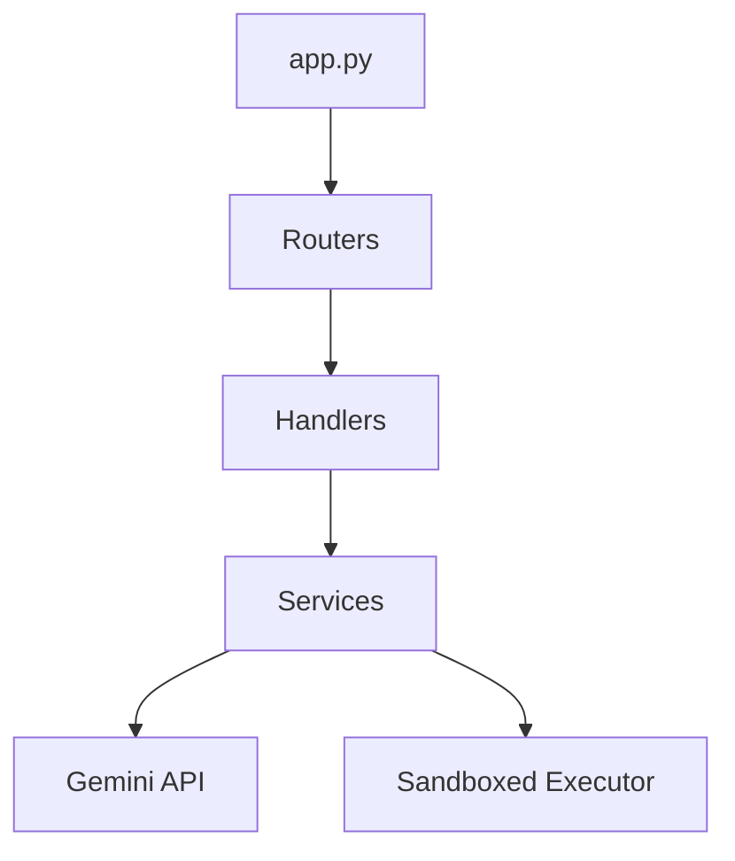

# Backend Context — AutoML Scientist

This document provides a comprehensive overview of the backend architecture, the supported user journeys, and the specific responsibilities of each module.

## 1. Architecture Overview

The backend is built with **Flask** and follows a **3-Layer Architecture** (Routers → Handlers → Services) to keep concerns separated and the code testable.



- **Routers (`backend/routers/`)**: Define the HTTP endpoints (`/api/...`). They handle the web layer (Flask Blueprints), parse incoming JSON/FormData, and return HTTP responses.
- **Handlers (`backend/handlers/`)**: Orchestrate the business logic. They connect the routers to the various services and manage the session state.
- **Services (`backend/services/`)**: Pure business logic modules. They know nothing about Flask or HTTP. They handle data processing, AI interactions, and code execution.
- **State Management**: Handled by `memory_store.py`, providing a temporary, in-memory session store (dictionary-based) mapped by `session_id`.

---

## 2. Supported User Journeys

This backend specifically handles **Journeys A through D** of the AutoML product:

### Journey A: Dataset Upload (`/api/upload`)
- **Action**: User uploads a `.csv` file.
- **Logic**: Validates the file extension, checks the file size (<100MB constraint), and reads it into a Pandas DataFrame.
- **Handler**: `upload_handler.py`

### Journey B & C: Profiling & Problem Type Detection (Internal)
- **Action**: The system automatically profiles the dataset immediately after upload.
- **Logic**: 
  - Computes missing values, duplicate rows, cardinality, and basic statistics.
  - Determines if the dataset is for `classification` or `regression` based on the target column.
  - Extracts a diverse sample of rows (head, middle, tail).
- **Service**: `profiler.py`

### Journey D: AI Cleaning Code Generation (`/api/codegen/<session_id>`)
- **Action**: User requests the dataset to be cleaned.
- **Logic**: 
  - Constructs a massive prompt using the profiled metadata.
  - Asks Google Gemini to write a robust Python function (`def clean(df)`) that addresses missing values, outlier capping, duplicate removal, feature encoding, scaling, and SMOTE for class imbalances.
  - **Self-Correction**: The generated code is immediately executed in a sandbox on a small sample of the data. If it fails (e.g., `NameError`), the traceback is sent back to Gemini up to 2 times for an automated fix.
- **Services**: `code_generator.py`, `gemini_api.py`, `executor.py`

---

## 3. Directory & File Map

```text
backend/
├── app.py                   # Application factory & server entry point
├── config.py                # Centralized environment variables (GEMINI_API_KEY, etc.)
├── memory_store.py          # In-memory dict holding user sessions & DataFrames
├── requirements.txt         # Python dependencies
├── routers/                 
│   ├── upload_router.py     # POST /api/upload
│   └── codegen_router.py    # POST /api/codegen/<session_id>
├── handlers/                
│   ├── upload_handler.py    # Orchestrates Journey A, B, C
│   └── codegen_handler.py   # Orchestrates Journey D
└── services/                
    ├── profiler.py          # Data statistics & metadata building
    ├── code_generator.py    # Prompt construction & AI code extraction
    ├── gemini_api.py        # Pure API client wrapper for google-genai
    └── executor.py          # Sandboxed Python exec() for testing AI code
```

---

## 4. Key Engineering Decisions

1. **Separation of LLM Logic**: The LLM interaction is split into `gemini_api.py` (pure network/API calls) and `code_generator.py` (prompt engineering and data strategy). This allows the API client to be reused for future journeys (like Journey H: Model Explanation).
2. **Robust Code Execution**: Using Python's `exec()` is dangerous. `executor.py` mitigates this by restricting the `__builtins__` and forcefully preventing any file system or OS interactions (`os`, `sys`, `open` are banned).
3. **Imbalance Handling**: The system calculates the class imbalance ratio. If the minority class is less than 30% of the majority, the AI is explicitly instructed to write code utilizing `imblearn.over_sampling.SMOTE`.
4. **Data Leakage Warnings**: `profiler.py` calculates the correlation matrix. Any feature correlating >0.95 with the target is flagged in the prompt so the LLM can add a warning comment to the generated code.

---

## 5. Running and Testing

**To run the server:**
```bash
cd backend
pip install -r requirements.txt
python app.py
```

**To run the automated pipeline test:**
```bash
python test_pipeline.py
```
*(This generates a messy synthetic dataset and runs it entirely through Journeys A-D, outputting the before/after DataFrame comparisons to the terminal).*
