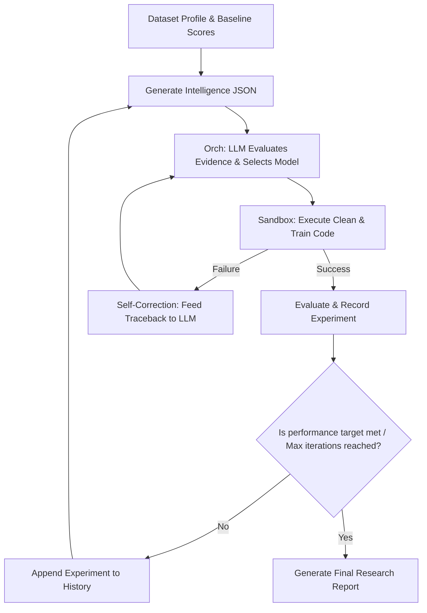

# Model Selection Framework: AutoML Scientist

This document explains the advanced model selection and execution framework of **AutoML Scientist**. It describes how the system elevates itself to a **research-grade AI agent** by avoiding the anti-pattern of sending raw datasets/dataframes directly to the LLM. 

Instead, the system utilizes a structured **Dataset Intelligence JSON**, a **Master LLM Prompt**, and an **Autonomous Research Loop** to reason like an experienced machine learning scientist.

---

## 1. Core Architecture Rationale: No Raw Dataframes

Directly uploading and passing raw datasets (e.g., pandas DataFrames) to an LLM is a major anti-pattern in production ML agent systems. AutoML Scientist addresses this with the following engineering decisions:

* **Token Optimization & Cost Reduction:** Tabular datasets can contain millions of rows and hundreds of columns. Sending them directly exhausts the LLM's context window and incurs massive token costs.
* **Information Density:** LLMs do not need to read raw numerical values row-by-row to understand a dataset. They need high-level statistical summaries, shape metadata, distributions, and relationship structures.
* **Security & Privacy:** Raw data is kept local and execution is run sandboxed in the Flask backend. Only anonymized statistics, column names, metadata, and performance metrics are transmitted to the LLM API.
* **Algorithmic Baseline Anchoring:** Before the LLM is invoked, the local [ML Engine](file:///c:/Programs/Hackday-1/trd.md) evaluates fast, deterministic baselines (e.g., Logistic Regression, shallow Decision Trees). This provides empirical data points to anchor the LLM's reasoning.

---

## 2. Dataset Intelligence JSON Schema (v1)

The backend [profiler.py](file:///c:/Programs/Hackday-1/trd.md) and [ml_engine.py](file:///c:/Programs/Hackday-1/trd.md) construct the **Dataset Intelligence JSON**. This payload summarizes the dataset shape, feature profiles, complexity, baselines, and experiment history.

```json
{
  "session": {
    "session_id": "8f8b8e0e-927b-4029-a1b4-71281cb9f25a",
    "dataset_name": "customer_churn.csv",
    "timestamp": "2026-08-01T12:30:00Z",
    "experiment_iteration": 1
  },

  "dataset": {
    "problem_type": "classification",
    "target_column": "churn",
    "rows": 10000,
    "columns": 12,
    "memory_usage_mb": 0.92,
    "duplicate_rows": 0,

    "feature_summary": {
      "numerical": 8,
      "categorical": 3,
      "boolean": 1,
      "datetime": 0,
      "text": 0
    }
  },

  "missing_values": {
    "overall_percentage": 1.25,
    "columns": [
      {
        "column": "Age",
        "missing_percentage": 15.0,
        "recommended_action": "impute"
      }
    ]
  },

  "categorical_analysis": [
    {
      "column": "Gender",
      "unique_values": 2,
      "high_cardinality": false,
      "dominant_class_percentage": 51.5
    },
    {
      "column": "Geography",
      "unique_values": 3,
      "high_cardinality": false,
      "dominant_class_percentage": 50.1
    }
  ],

  "numerical_analysis": [
    {
      "column": "CreditScore",
      "mean": 650.52,
      "median": 652.0,
      "std": 96.65,
      "variance": 9341.22,
      "skewness": -0.07,
      "kurtosis": -0.57,
      "min": 350.0,
      "max": 850.0,
      "outlier_percentage": 0.38
    }
  ],

  "target_analysis": {
    "class_distribution": {
      "0": 7963,
      "1": 2037
    },
    "imbalance_ratio": 3.91,
    "entropy": 0.72
  },

  "correlation": {
    "average": 0.12,
    "maximum": 0.85,
    "multicollinearity_detected": true,
    "highly_correlated_features": [
      ["Age", "Tenure"]
    ]
  },

  "feature_importance": [
    {
      "feature": "Age",
      "importance": 0.35
    },
    {
      "feature": "IsActiveMember",
      "importance": 0.22
    }
  ],

  "dataset_complexity": {
    "intrinsic_dimension": 6,
    "class_overlap": 0.28,
    "noise_estimation": 0.15,
    "non_linearity_score": 0.65,
    "feature_interaction_strength": 0.42,
    "clusterability": 0.31
  },

  "baseline_models": [
    {
      "model": "Logistic Regression",
      "cv_score": 0.79,
      "training_score": 0.79,
      "validation_score": 0.79,
      "training_time": 0.05,
      "prediction_time": 0.01,
      "overfit_gap": 0.0
    },
    {
      "model": "Decision Tree",
      "cv_score": 0.83,
      "training_score": 0.88,
      "validation_score": 0.82,
      "training_time": 0.02,
      "prediction_time": 0.01,
      "overfit_gap": 0.06
    }
  ],

  "current_pipeline": {
    "preprocessing": [
      "Median Imputation",
      "OneHot Encoding",
      "Standard Scaling"
    ],
    "feature_engineering": [],
    "feature_selection": [],
    "current_model": "Logistic Regression",
    "hyperparameters": {
      "C": 1.0,
      "penalty": "l2"
    }
  },

  "experiment_history": [
    {
      "iteration": 1,
      "model": "Logistic Regression",
      "score": 0.79,
      "changes": [
        "Baseline Model Setup"
      ],
      "diagnosis": "Linear baseline underfitting slightly, moderate class imbalance.",
      "result": "Accepted baseline"
    }
  ],

  "generated_code": {
    "cleaning_code": "def clean(df):\n    # Impute missing Age with median\n    df['Age'] = df['Age'].fillna(df['Age'].median())\n    # One-hot encode categoricals\n    df = pd.get_dummies(df, columns=['Gender', 'Geography'])\n    return df",
    "training_code": "model = LogisticRegression(C=1.0, penalty='l2')\nmodel.fit(X_train, y_train)"
  },

  "execution": {
    "status": "success",
    "execution_time": 1.2,
    "error": "",
    "traceback": ""
  }
}
```

---

## 3. Master LLM Prompt

This prompt is sent to the LLM Orchestrator during re-evaluation loops. It forces the LLM to think systematically like an AutoML Research Scientist, emphasizing empirical evidence, diagnosing errors, and structuring responses strictly as JSON.

```text
You are AutoML Scientist.
You are an autonomous Machine Learning Research Scientist.
Your purpose is NOT simply to maximize accuracy.
Your purpose is to think like an experienced ML researcher.

You are given:
• Complete dataset metadata
• Statistical analysis
• Dataset complexity metrics
• Baseline model performances
• Previous experiment history
• Current preprocessing pipeline
• Current model
• Generated Python code
• Execution logs
• Errors (if any)

You must carefully analyze everything before making any recommendation.
Never assume.
Base every decision on evidence.

--------------------------------------------------
OBJECTIVES
1. Understand the dataset.
2. Identify strengths and weaknesses of the current preprocessing.
3. Determine whether the chosen model family is appropriate.
4. Diagnose why the current pipeline produced its results.
5. Recommend concrete improvements.
6. Rewrite preprocessing code if necessary.
7. Rewrite training code if necessary.
8. Explain every recommendation.

--------------------------------------------------
Your diagnosis should consider:
• Dataset size
• Feature dimensionality
• Missing values
• Feature distributions
• Feature skewness
• Kurtosis
• Class imbalance
• Correlation
• Multicollinearity
• Outliers
• Noise estimation
• Non-linearity
• Clusterability
• Feature interaction strength
• Target entropy
• Feature importance
• Overfitting
• Underfitting
• Bias
• Variance
• Training time
• Prediction time
• Generalization gap
• Previous experiment history

--------------------------------------------------
Possible preprocessing improvements:
• Better imputation (Mean, Median, Mode, KNN)
• Feature scaling (Standard, MinMax, Robust)
• Feature normalization (PowerTransform)
• Target encoding
• One Hot Encoding
• Label / Ordinal Encoding
• Polynomial Features / Feature Crossing
• PCA / Dimensionality Reduction
• Feature Selection (Variance Threshold, SelectKBest)
• Outlier Removal / Winsorization
• Log / Box-Cox / Yeo-Johnson Transform
• Class Balancing (SMOTE, ADASYN, class_weight='balanced')
• Remove Target Leakage

--------------------------------------------------
Possible model improvements:
• Logistic Regression
• Ridge / Lasso / ElasticNet
• Decision Tree
• Random Forest
• Extra Trees
• XGBoost
• LightGBM
• CatBoost
• KNN
• Naive Bayes
• SVM
• Gradient Boosting
• HistGradientBoosting

--------------------------------------------------
Rules of Engagement:
• Never recommend a model without explaining WHY.
• Never recommend preprocessing without explaining WHY.
• Never repeat an experiment that already failed unless there is a significant modification.
• Return ONLY valid JSON. Do not include markdown. Do not include explanations outside the JSON. Follow the schema exactly.
```

---

## 4. Expected Response Schema

The LLM is strictly constrained to output **only valid JSON** matching the following schema. This ensures the backend [llm_client.py](file:///c:/Programs/Hackday-1/trd.md) can parse the recommendations programmatically, pass the code changes to the [executor.py](file:///c:/Programs/Hackday-1/trd.md) sandbox, and render the text explanations in the frontend [LiveNarration.jsx](file:///c:/Programs/Hackday-1/trd.md) panels.

```json
{
  "summary": {
    "dataset_type": "binary_classification",
    "difficulty": "Medium",
    "confidence": 0.88
  },

  "diagnosis": {
    "primary_issue": "Class Imbalance & Linear Underfitting",
    "secondary_issues": [
      "Missing values in Age column (15% missing)",
      "High correlation between Age and Tenure"
    ],
    "reasoning": "The linear baseline (Logistic Regression) yielded 79% accuracy but struggles with the minority class due to class imbalance. Decision Tree performed better, suggesting moderate non-linear relationships."
  },

  "recommended_pipeline": {
    "preprocessing": [
      "Median Imputation",
      "OneHot Encoding",
      "Standard Scaling"
    ],
    "feature_engineering": [
      "Create Age_Tenure_Ratio to resolve multicollinearity"
    ],
    "feature_selection": [],
    "recommended_model": "Random Forest",
    "hyperparameters": {
      "n_estimators": 150,
      "max_depth": 8,
      "class_weight": "balanced",
      "random_state": 42
    }
  },

  "code_changes": {
    "cleaning_code": "def clean(df):\n    # Impute missing Age with median\n    df['Age'] = df['Age'].fillna(df['Age'].median())\n    # Feature Engineering\n    df['Age_Tenure_Ratio'] = df['Age'] / (df['Tenure'] + 1)\n    # One-hot encode categoricals\n    df = pd.get_dummies(df, columns=['Gender', 'Geography'])\n    return df",
    "training_code": "model = RandomForestClassifier(n_estimators=150, max_depth=8, class_weight='balanced', random_state=42)\nmodel.fit(X_train, y_train)"
  },

  "expected_improvement": {
    "metric": "F1-Score",
    "estimated_gain": 0.05,
    "confidence": 0.85
  },

  "explanation": {
    "beginner": "We are upgrading our model to a Random Forest which can discover complex patterns. We are also balancing the dataset and creating new features to help the model learn better.",
    "technical": "Upgraded estimator to RandomForestClassifier to model non-linear boundaries. Configured class_weight='balanced' to handle the 4:1 class imbalance ratio, capped max_depth to 8 to avoid overfitting, and engineered interaction terms."
  },

  "next_experiment": {
    "title": "Tree Ensemble Scaling",
    "goal": "Verify if a non-linear ensemble with balanced weights resolves minority class error.",
    "success_criteria": "F1-score increases by at least 0.03 over Logistic Regression baseline."
  }
}
```

---

## 5. The Autonomous Research Loop

Rather than running a single, static model-picking query, the system maintains a running log of past experiments. Each iteration appends its outcomes to `experiment_history`. 

The LLM receives the **entire accumulative research ledger**. This architecture simulates a real-life scientific process:



### Simulation of State-Based Reasoning
1. **Experiment 1 (Baseline):** 
   * *Choice:* Logistic Regression. 
   * *Outcome:* 79% accuracy. 
   * *Diagnosis:* High variance and overfitting suspected.
2. **Experiment 2 (First Iteration):**
   * *Choice:* Random Forest. 
   * *Outcome:* 85% accuracy (but train=98%, val=83%).
   * *Diagnosis:* Overfitting confirmed (Generalization gap = 15%).
3. **Experiment 3 (Second Iteration):**
   * *Choice:* Random Forest with `max_depth=5` and `min_samples_leaf=4`.
   * *Outcome:* Train=86%, Val=84%.
   * *Diagnosis:* Overfit gap successfully constrained to 2%. Transition to boosting models if higher capacity is desired.

This iterative loop prevents repeating failed experiments and guides the system to converge on high-quality pipelines autonomously.

---

## 6. Integration in the Codebase

For detailed instructions on implementation within the Flask backend and React frontend:
* Review the product features in [prd.md](file:///c:/Programs/Hackday-1/prd.md)
* Inspect endpoint definitions, SSE event payloads, and state caching structures in [trd.md](file:///c:/Programs/Hackday-1/trd.md)
