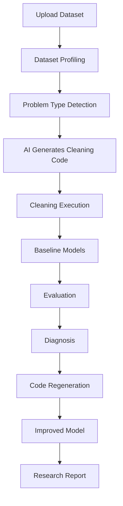
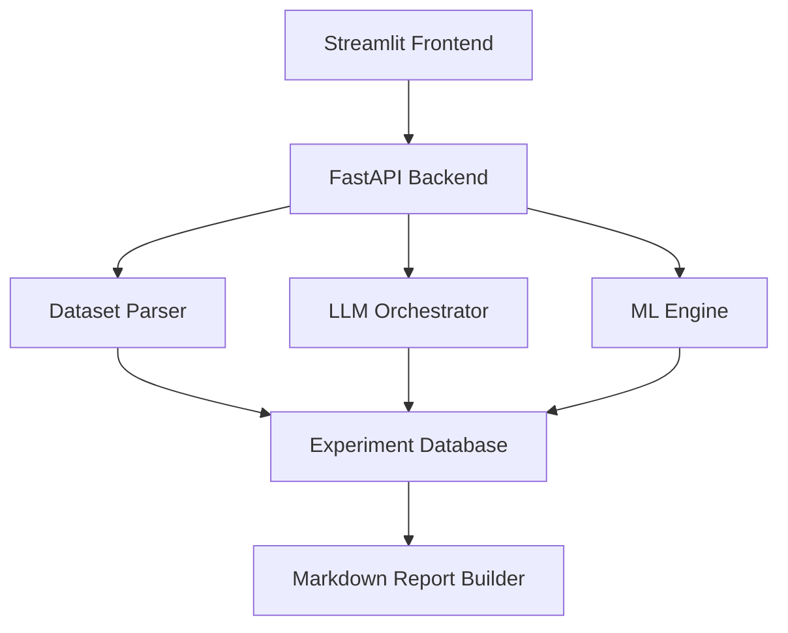

# Product Requirements Document (PRD): AutoML Scientist
## An Autonomous AI Research Collaborator for Tabular Machine Learning

* **Version:** 2.0 (Hackathon Edition)
* **Status:** Product Requirements Document
* **Author:** Team \_\_
* **Target Build Time:** 24–36 Hours

---

## Executive Summary

AutoML Scientist is an autonomous AI research collaborator designed to perform the work of a junior machine learning scientist.

Instead of simply training models and returning an accuracy score, the system analyzes datasets, generates preprocessing code, evaluates multiple machine learning approaches, diagnoses poor performance, rewrites its own implementation, and transparently explains every decision throughout the workflow.

Unlike traditional AutoML systems, AutoML Scientist exposes its reasoning process, making machine learning understandable, interactive, and explainable.

The product transforms machine learning from a black-box optimization task into an observable scientific workflow.

---

## Vision

Enable anyone—from students to professional data scientists—to collaborate with an AI capable of conducting reproducible machine learning experiments while explaining every decision it makes.

The ultimate vision is an AI that behaves like a junior research scientist rather than a software tool.

---

## Problem Statement

Modern AutoML platforms focus almost entirely on optimization. They automatically search hundreds of models and hyperparameters but provide little insight into:

* Why a model was selected
* Why preprocessing decisions were made
* Why accuracy is poor
* How the pipeline could improve
* What failed during experimentation

Existing solutions optimize performance. They do not teach, they do not narrate, and they do not reason transparently. This creates a gap between automation and understanding.

AutoML Scientist addresses this gap by making the reasoning process the primary product.

---

## Objectives

The system shall:

* Accept arbitrary tabular CSV datasets
* Automatically infer problem type
* Generate dataset-specific preprocessing code
* Execute generated code safely
* Build multiple ML baselines
* Compare competing models
* Diagnose poor performance
* Rewrite preprocessing/model code autonomously
* Retrain after improvements
* Produce a narrated research report
* Display the complete experimentation history

---

## Non-Goals

For the hackathon, the following are intentionally excluded:

* Image classification
* NLP datasets
* Audio processing
* Large-scale distributed training
* GPU clusters
* Production deployment
* MLOps pipelines
* Continuous model serving
* Enterprise authentication
* Data versioning

---

## Target Users

### Beginner Data Scientists
Need explanations instead of black-box outputs.

### Students
Want to understand why algorithms succeed or fail.

### ML Engineers
Need rapid baseline generation.

### Researchers
Need reproducible experimentation.

---

## User Journey



---

## Core Features

### 1. Dataset Intelligence
Upon upload, the system automatically detects:
* Classification vs. Regression
* Binary vs. Multiclass
* Missing values
* Outliers
* Feature types
* Target variable
* Cardinality
* Class imbalance
* Duplicate rows

**Outputs include:**
* Dataset summary
* Feature overview
* Missing value report
* Correlation heatmap
* Statistical profile

### 2. AI Preprocessing Agent
Instead of using fixed preprocessing templates, an LLM writes preprocessing code dynamically.

* **Inputs:** Dataset metadata, feature statistics, sample rows.
* **Outputs:** 
  ```python
  def clean(df):
      # Generated code to handle missing values, outliers, encoding, etc.
      return df
  ```

The generated code is executed automatically. If execution fails:
1. Error is captured.
2. Traceback is summarized.
3. AI rewrites the function.
4. Retry is executed.
* **Maximum retries:** 2

### 3. Autonomous Model Selection & Decision Framework

The system utilizes a **multi-layered decision framework** to evaluate the dataset and select the optimal model. Instead of randomly searching, the AI follows four progressive evaluation layers:

#### Layer 1: Problem Type & Target Cardinality
* **Cardinality Analysis:** 
  * Target unique values $\le 10$ or target dtype is object/categorical $\rightarrow$ **Classification**
  * Target unique values $> 10$ and target dtype is numeric $\rightarrow$ **Regression**
* **Class Configuration:** Identifies if classification is binary or multiclass to select matching estimators and evaluation metrics (e.g., ROC-AUC vs. Macro F1).

#### Layer 2: Baseline vs. Non-Linear Complexity Split
The AI initiates execution by training fast, low-complexity baselines:
* **Classification Baselines:** Logistic Regression, Shallow Decision Tree (max depth = 3)
* **Regression Baselines:** Linear Regression, Shallow Decision Tree Regressor (max depth = 3)
* **Complexity Heuristic:** 
  * If the Linear baseline matches or exceeds the Decision Tree accuracy, the dataset is marked as **linear**. The AI prioritizes regularized linear models (Ridge/Lasso/ElasticNet).
  * If the Decision Tree significantly outperforms the linear baseline, the dataset contains **non-linear relationships**. The AI activates tree-based ensembles.

#### Layer 3: Dataset Scale, Sparsity, & Feature Constraints
The AI analyzes the dataset dimensions and shape:
* **Data Scale (Row Count):**
  * Small datasets ($< 5,000$ rows) $\rightarrow$ Recommends **Random Forest** or **Extra Trees** (robust to overfitting on small sample sizes).
  * Medium/Large datasets ($\ge 5,000$ rows) $\rightarrow$ Recommends boosting algorithms: **XGBoost**, **LightGBM**, or **CatBoost**.
* **Sparsity & Categorical Cardinality:**
  * High-cardinality categorical variables present $\rightarrow$ Recommends **CatBoost** (natively handles categorical features efficiently).
  * High dimensional/sparse feature matrices (due to One-Hot Encoding) $\rightarrow$ Recommends linear estimators with L1/L2 penalties.

#### Layer 4: Diagnostic Feedback & Iterative Correction
After initial model training, the AI monitors performance metrics and adjusts dynamically:
* **High Variance (Overfitting):** If Train metric $-$ Validation metric $> 15\%$, the AI adds model constraints (e.g., reduces `max_depth`, increases `min_samples_leaf`, or increases `alpha` regularization parameters).
* **Severe Class Imbalance:** If target class distribution variance is high, the AI enables class-balancing parameters in scikit-learn (`class_weight='balanced'`).
* **Underfitting:** If both Train and Validation scores are low, the AI escalates model complexity (e.g., increases the number of estimators, increases tree depth, or switches to a more expressive algorithm family).

Each final recommendation is generated with a clear, written explanation outlining which layers triggered the choice.

### 4. Experiment Engine
Every experiment is recorded.

* **Example - Experiment #1:**
  * **Model:** Random Forest
  * **Accuracy:** 76%
  * **Reason:** Baseline tree ensemble
  * **Status:** Accepted
* **Example - Experiment #2:**
  * **Model:** Gradient Boosting
  * **Accuracy:** 81%
  * **Reason:** Higher non-linearity detected
  * **Status:** Improved

Every attempt remains visible. Nothing is hidden.

### 5. Autonomous Diagnosis
If performance falls below an acceptable threshold, the AI performs diagnosis.

* **Possible diagnoses include:** Overfitting, underfitting, data leakage, high dimensionality, poor preprocessing, wrong model family, feature imbalance, class imbalance.
* **Evidence used:** Cross-validation, train accuracy, validation accuracy, confusion matrix, residual analysis, feature importance.

### 6. Self-Correction Loop
After diagnosis, the AI generates improved code.

* **Possible improvements include:** Feature engineering, different encoders, better imputations, hyperparameter changes, switching algorithms, removing leakage, balancing classes.
* **Pipeline Flow:**
  $$\text{Diagnosis} \rightarrow \text{Rewrite Code} \rightarrow \text{Execute} \rightarrow \text{Retrain} \rightarrow \text{Compare Results} \rightarrow \text{Repeat (Max 2 attempts)}$$

### 7. Live Research Narration
Instead of displaying loading indicators, the interface streams research notes.

* **Example Narration:**
  > Reading dataset...  
  > Detected binary classification problem.  
  > Cabin column contains 78% missing values. Removing Cabin.  
  > Age appears informative.  
  > Generating preprocessing code.  
  > Training Random Forest...  
  > Validation accuracy: 74%  
  > Model appears to overfit. Constraining tree depth.  
  > Retraining...  
  > Validation accuracy improved to 82%.  

This narration serves as a digital lab notebook.

### 8. Visualization Dashboard
Dashboard includes:
* Dataset Overview
* Missing Values representation
* Correlation Matrix
* Feature Importance
* Confusion Matrix
* ROC Curve
* Precision–Recall Curve
* Model Leaderboard
* Accuracy History
* Experiment Timeline

### 9. Research Report
Generated automatically. Can be exported as Markdown.

**Sections include:**
* Executive Summary
* Dataset Description
* Cleaning Decisions
* Model Selection
* Experiments Ledger
* Failures & Corrections
* Performance Metrics
* Feature Importance
* Recommendations
* Future Improvements

---

## Functional Requirements

### Dataset Upload
* **Supports:** CSV
* **Maximum size:** 100 MB

### Profiling
* **Generate:** Missing values, correlations, statistics, target detection.

### Code Generation
* Generate preprocessing code dynamically.

### Execution
* Execute generated code, capture errors, and retry automatically.

### Model Training
* **Classification Models:** Logistic Regression, Decision Tree, Random Forest, Gradient Boosting, XGBoost.
* **Regression Models:** Linear Regression, Decision Tree, Random Forest Regressor.

### Evaluation
* **Classification Metrics:** Accuracy, Precision, Recall, F1, ROC AUC.
* **Regression Metrics:** RMSE, MAE, R².

---

## Non-Functional Requirements

* **Pipeline Execution:** < 5 minutes
* **Retry Latency:** < 30 seconds
* **Frontend Responsiveness:** Immediate UI updates and real-time streaming
* **Supported Browsers:** Chrome, Firefox, Edge

---

## Technical Architecture (Original Design)



---

## Recommended Tech Stack (Original Design)

* **Frontend:** Streamlit
* **Backend:** FastAPI
* **Machine Learning:** Scikit-learn, XGBoost, LightGBM
* **LLM:** Claude, GPT-5, Gemini
* **Visualization:** Plotly, Matplotlib
* **Data:** Pandas, NumPy
* **Profiling:** ydata-profiling

---

## Success Metrics

The hackathon build is successful if it can successfully complete the following within five minutes:
1. Upload a dataset.
2. Automatically profile it.
3. Generate preprocessing code.
4. Execute the code.
5. Train baseline models.
6. Explain every decision.
7. Detect poor performance.
8. Rewrite its own pipeline.
9. Improve model quality.
10. Produce a readable research report.

---

## Competitive Positioning

| Feature / Aspect | Existing AutoML | AutoML Scientist |
| :--- | :--- | :--- |
| **Primary Goal** | Finds best model | Explains every decision |
| **Optimization** | Hidden optimization | Transparent experimentation |
| **Preprocessing** | Static pipelines | AI-generated preprocessing |
| **Execution** | Stops after training | Self-corrects automatically |
| **Reporting** | Accuracy score only | Research narrative + accuracy |
| **Workflow** | Leaderboards | Scientific workflow |

---

## Future Roadmap

### Phase 2
* Time-series support
* Feature engineering agents
* Bayesian optimization
* SHAP explanations
* Multi-agent collaboration
* Reinforcement-based experimentation

### Phase 3
* Image datasets
* NLP datasets
* AutoML competitions
* Cloud deployment
* Continuous learning
* Research paper generation

---

## Elevator Pitch

AutoML Scientist is an AI research collaborator that doesn't just build machine learning models—it thinks like a scientist. It profiles data, writes preprocessing code, trains competing models, diagnoses failures, rewrites its own pipeline, and transparently explains every experiment. Instead of delivering a black-box model, it delivers an observable scientific process, making machine learning understandable, reproducible, and collaborative.
