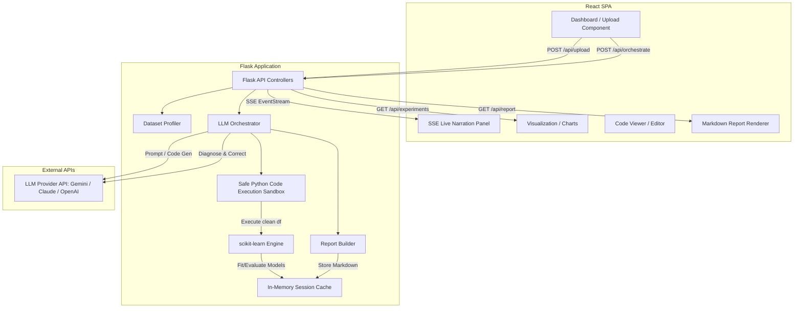

# Technical Requirements Document (TRD): AutoML Scientist

This document details the system design, file structure, API endpoints, in-memory state tracking, and workflows for **AutoML Scientist** using the specified technology stack:
* **Frontend:** React (SPA, styled with CSS/Tailwind)
* **Backend:** Flask (Python 3.10+)
* **Machine Learning:** Scikit-learn (sklearn), Pandas, NumPy
* **State Management:** In-Memory Session Cache (No database storage)
* **Real-time Streaming:** Server-Sent Events (SSE)

---

## 1. System Architecture & Component Mapping

Below is the high-level technical architecture showing how the React frontend, Flask backend, scikit-learn, and the LLM Orchestrator interact. Since data persistence is not required, all dataset metadata, experiment metrics, narration logs, and generated reports are managed strictly in-memory within the Flask application context using a short-lived memory session.



---

## 2. Directory Structure

A standardized repository structure for a React frontend and Python Flask backend project is laid out below:

```text
automl-scientist/
│
├── backend/                  # Flask Backend
│   ├── app.py                # Main Entrypoint
│   ├── config.py             # App Configuration (Keys, temporary storage limits)
│   ├── memory_store.py       # In-memory session state management
│   ├── requirements.txt      # Python dependencies
│   │
│   ├── controllers/          # API Route Handlers
│   │   ├── __init__.py
│   │   ├── upload.py         # File uploading and profiling controller
│   │   ├── orchestrate.py    # SSE pipeline runner controller
│   │   └── history.py        # Experiment history & reports controller
│   │
│   └── services/             # Core Business Logic
│       ├── __init__.py
│       ├── profiler.py       # Dataset profiling (missing values, correlations)
│       ├── llm_client.py     # LLM interactions (Gemini/Claude wrapper)
│       ├── executor.py       # Sandboxed code runner (safe execution)
│       ├── ml_engine.py      # scikit-learn training & metrics evaluator
│       └── report_builder.py # Generates the final Markdown research report
│
├── frontend/                 # React Frontend (Vite)
│   ├── package.json
│   ├── vite.config.js
│   ├── index.html
│   │
│   ├── src/
│   │   ├── main.jsx
│   │   ├── App.jsx
│   │   ├── index.css
│   │   │
│   │   ├── components/       # Shared UI Components
│   │   │   ├── FileUpload.jsx
│   │   │   ├── LiveNarration.jsx
│   │   │   ├── DatasetOverview.jsx
│   │   │   ├── ExperimentTimeline.jsx
│   │   │   ├── CodeEditor.jsx
│   │   │   └── ReportViewer.jsx
│   │   │
│   │   └── hooks/
│   │       └── useEventSource.js # Custom hook for SSE subscriptions
│   │
│   └── public/
│
└── README.md
```

---

## 3. In-Memory Session State Schema

Since database storage is explicitly excluded to ensure user privacy and maintain a one-time execution model, the system maintains a transient, in-memory state engine in `memory_store.py`. This state is indexed by a unique `session_id` (a short-lived UUID generated when the frontend loads) and persists only for the duration of the server process or until the user refreshes/leaves.

### In-Memory Data Structure
```python
# memory_store.py
from dataclasses import dataclass, field
from typing import Dict, List, Any
from datetime import datetime

@dataclass
class DatasetState:
    session_id: str
    filename: str
    df_raw: Any                # Original pandas DataFrame (kept in memory)
    df_clean: Any              # Preprocessed pandas DataFrame
    problem_type: str          # "classification" or "regression"
    target_column: str
    summary: Dict[str, Any]
    created_at: datetime = field(default_factory=datetime.utcnow)

@dataclass
class ExperimentState:
    run_number: int
    model_name: str
    hyperparameters: Dict[str, Any]
    metrics: Dict[str, Any]
    code_snippet: str
    status: str                # "Accepted" | "Improved" | "Failed"
    reason: str

@dataclass
class SessionState:
    dataset: DatasetState = None
    experiments: List[ExperimentState] = field(default_factory=list)
    narration_logs: List[str] = field(default_factory=list)
    report_markdown: str = ""

# Primary global memory lookup table
session_store: Dict[str, SessionState] = {}
```

---

## 4. API Endpoints Specification

### 4.1 Dataset Upload & Profile
* **Endpoint:** `POST /api/upload`
* **Content-Type:** `multipart/form-data`
* **Request Payload:**
  - `file`: CSV file up to 100MB
  - `session_id`: Unique UUID generated by the React client.
* **Response Payload (`200 OK`):**
  ```json
  {
    "session_id": "8f8b8e0e-927b-4029-a1b4-71281cb9f25a",
    "filename": "customer_churn.csv",
    "problem_type": "classification",
    "target_column": "churn",
    "summary": {
      "num_rows": 10000,
      "num_cols": 12,
      "missing_values": {"Age": 15, "Balance": 0},
      "columns": {
        "Age": "numeric",
        "Gender": "categorical"
      }
    }
  }
  ```

### 4.2 Pipeline Orchestration (SSE Stream)
* **Endpoint:** `GET /api/orchestrate/<session_id>`
* **Content-Type:** `text/event-stream`
* **Description:** Initiates the AutoML workflow for the given active session and streams narration events to the UI.
* **Stream Events Layout:**
  * **Event type: `message`**
    ```json
    {
      "status": "in_progress",
      "phase": "CodeGen",
      "message": "Generating preprocessing code for missing values..."
    }
    ```
  * **Event type: `experiment`**
    ```json
    {
      "status": "experiment_complete",
      "run_number": 1,
      "model_name": "Random Forest Classifier",
      "metrics": {"accuracy": 0.76, "f1_score": 0.73},
      "explanation": "Baseline tree ensemble trained successfully."
    }
    ```
  * **Event type: `done`**
    ```json
    {
      "status": "completed",
      "message": "AutoML Scientist has completed research successfully."
    }
    ```

### 4.3 Experiment History
* **Endpoint:** `GET /api/experiments/<session_id>`
* **Response Payload (`200 OK`):**
  ```json
  [
    {
      "run_number": 1,
      "model_name": "Decision Tree",
      "metrics": {"accuracy": 0.71},
      "status": "Accepted",
      "reason": "Initial baseline model"
    },
    {
      "run_number": 2,
      "model_name": "Random Forest",
      "metrics": {"accuracy": 0.79},
      "status": "Improved",
      "reason": "Tree ensemble resolving high-variance issues"
    }
  ]
  ```

### 4.4 Research Report Export
* **Endpoint:** `GET /api/report/<session_id>`
* **Response Payload (`200 OK`):**
  ```json
  {
    "markdown_content": "# AutoML Scientist Research Report\n..."
  }
  ```

---

## 5. LLM-Driven Code Generation & Safe Execution Model

One of the central requirements is the dynamic creation of preprocessing code by an LLM and its safe execution.

### 5.1 Preprocessing Prompt Strategy
The backend will feed the LLM the following metadata:
1. Dataset summary (missing percentages, cardinalities, types).
2. Data sample (top 5 rows).
3. The targeted column.

The LLM is strictly instructed to return **only** a valid Python script containing a function signature:
```python
import pandas as pd
import numpy as np

def clean(df: pd.DataFrame) -> pd.DataFrame:
    # LLM-written cleaning logic
    return df
```

### 5.2 Safe Sandbox Execution Engine
Because the code is dynamically generated, running it poses security risks and potential runtime exceptions. The implementation uses Python's standard execution tools wrapper:

```python
import sys
import io
import pandas as pd

def run_generated_code(code_string: str, df: pd.DataFrame) -> pd.DataFrame:
    """
    Executes the generated code_string on a copy of the dataframe
    within a sandboxed execution namespace.
    """
    df_copy = df.copy()
    
    # Restrict built-ins to prevent malicious file writes / shell commands
    allowed_builtins = {
        'abs': abs, 'min': min, 'max': max, 'len': len, 'print': print,
        'int': int, 'float': float, 'str': str, 'dict': dict, 'list': list,
        'set': set, 'range': range, 'enumerate': enumerate, 'zip': zip
    }
    
    local_namespace = {
        'df': df_copy,
        'pd': pd,
        'np': np
    }
    
    global_namespace = {
        "__builtins__": allowed_builtins
    }
    
    # Capture standard outputs/errors
    stdout_capture = io.StringIO()
    sys.stdout = stdout_capture
    
    try:
        # Execute script definitions
        exec(code_string, global_namespace, local_namespace)
        
        # Invoke clean function
        clean_func = local_namespace.get('clean')
        if not clean_func:
            raise ValueError("Function 'clean(df)' was not defined by the agent.")
            
        cleaned_df = clean_func(df_copy)
        return cleaned_df, None
    except Exception as e:
        # Return traceback text to send back to the LLM for self-correction
        import traceback
        tb_str = traceback.format_exc()
        return None, tb_str
    finally:
        sys.stdout = sys.__stdout__
```

### 5.3 Self-Correction Retry Loop
If `run_generated_code` returns an error traceback, the LLM client is reinvoked with a prompt containing:
- The original generated code.
- The execution traceback error.
- Instruction to correct the code.

This loops for a **maximum of 2 retries** before falling back to a standard, static scikit-learn preprocessing pipeline.

---

## 6. Machine Learning Engine (scikit-learn)

All ML operations are handled natively in Python using `scikit-learn`:

### 6.1 Problem Type Inference
* The service counts unique target values:
  * $\le 10$ unique values or target type is object/category $\rightarrow$ Classification.
  * $> 10$ unique values and target type is numeric $\rightarrow$ Regression.

### 6.2 ML Workflow
1. **Baselines:** 
   * Classification: `LogisticRegression()`, `DecisionTreeClassifier(max_depth=3)`
   * Regression: `LinearRegression()`, `DecisionTreeRegressor(max_depth=3)`
2. **K-Fold Evaluation:** Run 5-fold Cross Validation (`cross_val_score`) to collect baseline metrics.
3. **Advanced Selection Recommendation:** The LLM recommends a model configuration (e.g., `RandomForestClassifier`, `GradientBoostingClassifier`).
4. **Execution:** The ML Engine instantiates the scikit-learn estimator, trains it, and computes metrics:
   * Classification: `accuracy_score`, `precision_score`, `recall_score`, `f1_score`, `roc_auc_score`.
   * Regression: `mean_squared_error` (RMSE), `mean_absolute_error`, `r2_score`.
5. **Diagnosis Analysis:** A comparison service runs:
   * Overfitting Check: If Train Metric $-$ Test Metric $> 0.15$.
   * Class Imbalance Check: Standard deviation of target distribution counts $> 0.25$.
   * Data Leakage: If Test Metric is suspiciously $1.0$.

---

## 7. Frontend (React) Design System & Components

The interface is structured as a single-page app displaying a dark/modern dashboard layout.

### 7.1 Component Flow
1. **Landing / File Drop:** Large interactive file dropzone for uploading CSV files. Shows upload progress.
2. **Analysis Dashboard (Layout columns):**
   * **Left Panel:** Live Narration Output (Terminal-style logs updating line-by-line via SSE).
   * **Middle Panel:** Visualizations (Interactive correlation heatmaps, missing value charts, feature importances).
   * **Right Panel:** Experiment Ledger (A timeline of trained models, accuracy scores, status tags, and LLM reasoning explanations).
3. **Interactive Code Drawer:** Shows the generated `clean(df)` Python code currently running, highlighting any errors.
4. **Research Report Tab:** Displays the rendered Markdown report, with a button to trigger `window.print()` or export `.md` file directly.

### 7.2 Narration Streaming Implementation
The React UI listens to the EventStream:
```javascript
import { useEffect, useState } from "react";

export function LiveNarration({ sessionId }) {
  const [logs, setLogs] = useState([]);

  useEffect(() => {
    if (!sessionId) return;

    const eventSource = new EventSource(`/api/orchestrate/${sessionId}`);

    eventSource.onmessage = (event) => {
      const data = JSON.parse(event.data);
      setLogs((prevLogs) => [...prevLogs, data.message]);
    };

    eventSource.onerror = () => {
      eventSource.close();
    };

    return () => {
      eventSource.close();
    };
  }, [sessionId]);

  return (
    <div className="terminal-window">
      <h3>Live Research Narration</h3>
      <div className="terminal-body">
        {logs.map((log, index) => (
          <div key={index} className="log-line">> {log}</div>
        ))}
      </div>
    </div>
  );
}
```

---

## 8. Non-Functional Requirements & Security Guidelines

### 8.1 Execution Performance
* **Memory Limits:** The Flask application will constrain datasets to a maximum of 100MB. Large dataframes are downsampled if profiling runs slow.
* **Timeout Limits:** All ML baseline fits and evaluations will execute within a thread executor pool with a hard 4-minute timeout to guarantee responses.

### 8.2 Security & Isolation
* **Safe Imports:** Within the sandbox executor, standard `import os`, `import sys`, `import subprocess`, and standard file writes are blocked via custom local scopes and namespace restriction.
* **File Upload Constraints:** All file uploads are checked for extensions and renamed using `werkzeug.utils.secure_filename`.

---

## 9. Verification & Setup Checklist

1. **Backend Environment Setup:**
   * Install Python 3.10+.
   * Create virtual environment: `python -m venv venv`
   * Activate & install dependencies: `pip install flask pandas scikit-learn openai`
2. **LLM Provider Authentication:**
   * Configure `GEMINI_API_KEY` or `OPENAI_API_KEY` in `config.py` (or load from `.env`).
3. **Frontend Development Setup:**
   * Initialize Vite React app: `npm create vite@latest frontend -- --template react`
   * Install charting dependencies: `npm install recharts lucide-react`
4. **Integration Test Run:**
   * Start Flask backend (`python app.py`).
   * Start React development server (`npm run dev`).
   * Run end-to-end integration: Upload `iris.csv` or `titanic.csv` and ensure narration logs stream correctly and a scikit-learn Random Forest model is successfully evaluated.
